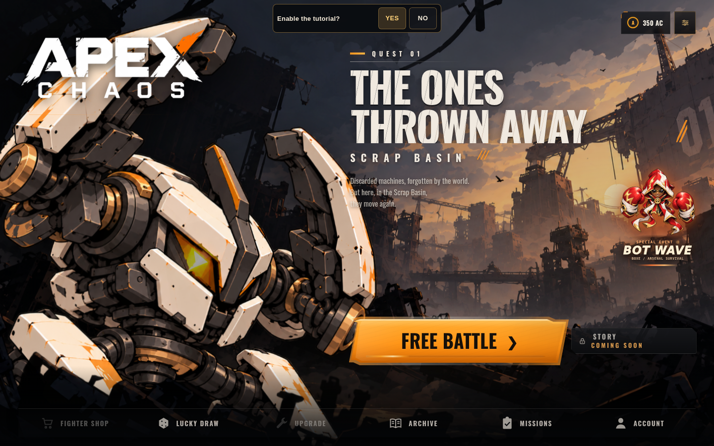

<div align="center">

# APEX CHAOS

**Five arenas. Distinct fighters. Unpredictable battles.**

A playable HTML5 arena action game built around character abilities, weapon pickups, environmental hazards, and fast local combat.

### [▶ PLAY APEX CHAOS — BROWSER DEMO](https://realbae.itch.io/apex-chaos)

**BOT Battle · Local 1v1 · BOT WAVE · Five Total Evolution arenas**

[Game on itch.io](https://realbae.itch.io/apex-chaos) · [Source code](https://github.com/Khanh-glitch/APEX-CHAOS) · [Report an issue](https://github.com/Khanh-glitch/APEX-CHAOS/issues)


</div>

## Overview

APEX CHAOS is an independently developed, top-down, browser-based arena fighter. Each fighter has a distinct ability kit; movement, timing, weapon selection, and the arena environment determine the outcome. The current `main` branch is the **R5 × Total Evolution** source integration. This is an **in-development game**, not a claim of final balance, universal device performance, or finished online multiplayer.

### Play modes

| Mode | Experience |
| --- | --- |
| **BOT Battle** | Choose a fighter and take on an AI-controlled opponent. |
| **Local 1v1** | Two players compete on the same device. |
| **BOT WAVE** | A separate PvE wave-combat experience. |

The game has desktop and mobile browser layouts. In-game screens provide the applicable controls; they can differ by mode and input device. **For the public game, use the itch.io link above**, not a local development server.

### Five arenas

| Arena | Defining feature |
| --- | --- |
| **Scrap Basin Foundry** | Furnace vents, molten slag, and electromagnetic bumpers. |
| **Cryo-Turbine Vault** | Coolant cores, frost fields, and rotating machinery. |
| **Lorentz Railyard** | Projectile-acceleration gates and overloaded rails. |
| **Obsidian Prism Sanctum** | Refraction monoliths and energy lines that affect combat. |
| **APEX Tournament Pro** | A competitive stage without environmental hazards. |

The roster includes Newbot, Hunter, BOXE, Shuri, Crystala, Frost, and additional fighters. The game also contains a Gold-style presentation layer, fighter art, audiovisual effects, Arsenal weapon systems, and progression interfaces.

<div align="center">



*Home interface captured from a compiled build.*

</div>

## Source architecture

This repository contains **editable production source**, not an already-built itch.io ZIP. The game is delivered by a Vite build with several embedded or deferred classic JavaScript runtimes.

| Path | Role |
| --- | --- |
| `src/` | React 18 entry, Home and battle UI, runtime loading, localization, account facade, and game integration. |
| `src/game/runtimeManifest.js` | Runtime script manifest and deferred loading order. |
| `public/apexEngine.js` | Core arena engine. |
| `public/game/` | Fighter combat, Arsenal, modes, BOT WAVE integration, Gold bridge, and Total Evolution arenas. |
| `public/assets/`, `public/gold/`, `public/bot-wave/` | Production game art/audio, Gold shell, and BOT WAVE game page. |
| `gold-mission-account/` | Isolated account and missions UI, built into the HTML5 game. |
| `result-gold/` | Isolated match-result presentation, built into the HTML5 game. |
| `docs/gold-ui/current/` | Canonical Gold source and manifests used by the build/acceptance toolchain; **not historical clutter**. |
| `tools/`, `scripts/`, `.github/workflows/` | Build, package, runtime integrity, and reproducible release/QA checks. |

**Why some non-game files remain:** the Gold sources, pinned audio lock, packaging scripts, test fixtures, and active acceptance workflows are prerequisites for a reproducible and auditable release. Historical experiments and detached assets belong on the archive branch instead.

## Develop locally

**Prerequisites:** Node.js **22**; pnpm **9.15.9** via Corepack; npm is also used automatically to build the isolated Gold UI subprojects. No cloud credentials are required for the current guest-first public build.

```bash
corepack enable
pnpm install --frozen-lockfile
pnpm dev
```

Open the **local development address printed by Vite**. Do not open the source `index.html` directly with `file://`, because the application needs module and asset serving. A local dev address is not the public game link.

### Build and validate

```bash
node scripts/check-arena-integration.mjs
node scripts/check-arena-boundaries.mjs
pnpm test:runtime-revision
node tools/buildGoldCutover.mjs --check
pnpm build
pnpm test:shipping-dist
```

`pnpm build` produces `dist/` and runs the Gold compilers, audio integrity/materialization, asset audit, and shipping-prune checks. `pnpm test:shipping-dist` verifies that required production assets survived pruning and that excluded assets do not leak into the build. The production HTML5 and nested-itch Chromium acceptance workflow is [APEX CHAOS Production / HTML5 Acceptance](https://github.com/Khanh-glitch/APEX-CHAOS/actions/workflows/r5-five-arenas-source-acceptance.yml).

### Package for itch.io

```bash
pnpm build
printf '%s\n' "$(git rev-parse HEAD)" > dist/ITCH_GUEST_BUILD_SHA.txt
node tools/packItchPortable.mjs
(cd dist-itch-html5 && zip -qr ../APEX-CHAOS-itch-html5.zip .)
```

Upload the ZIP as an **HTML5 project** on itch.io. The ZIP must have `index.html` at its root. The packaging script rewrites first-party URLs for itch.io's nested hosting path. Test the uploaded build in a real browser before publishing it; **pushing a GitHub commit does not automatically update the itch.io game**.

The repository also includes `netlify.toml` for the `dist/` web build. Hosting the web build and packaging for itch.io are separate distribution paths.

## Quality and limitations

The R5 source integration has an automated production build and Chromium-based HTML5 acceptance gate. A passing gate demonstrates only the scenarios it actually exercises; it is not a guarantee of steady frame pacing on every device, arena, and fighter matchup.

A separate **Arsenal Product Acceptance** workflow is retained even though it has known inherited headless combat regressions. These are tracked publicly in [issue #131](https://github.com/Khanh-glitch/APEX-CHAOS/issues/131). Do not interpret a passing packaging smoke test as closing that gameplay QA debt.

The current public release is **guest-first**. Online multiplayer and production cloud-account features should not be assumed complete simply because the source contains future-facing integrations.

## History, archives, and rights

Large historical evidence, reference assets, obsolete workflows, and experiments have been removed from the default checkout without rewriting Git history. The full state immediately before the latest runtime-hygiene cleanup is preserved at:

**[archive/main-pre-runtime-hygiene-20261117](https://github.com/Khanh-glitch/APEX-CHAOS/tree/archive/main-pre-runtime-hygiene-20261117)**

Earlier snapshots include [pre-hard-source-prune](https://github.com/Khanh-glitch/APEX-CHAOS/tree/archive/main-pre-hard-source-prune-20261117). Archived content is recoverable without restoring it to `main`. Production assets and game logic remain on `main`; removed legacy evidence should not be mistaken for a missing game dependency.

APEX CHAOS is an independent project. **No open-source license is granted by this repository.** The source being publicly viewable does not grant permission to reuse or redistribute the game, code, characters, or assets. Third-party components remain subject to their original licenses, and rights/provenance should be reviewed before any transfer or commercial redistribution.

---

<div align="center"><sub>APEX CHAOS · Built for the arena.</sub></div>
