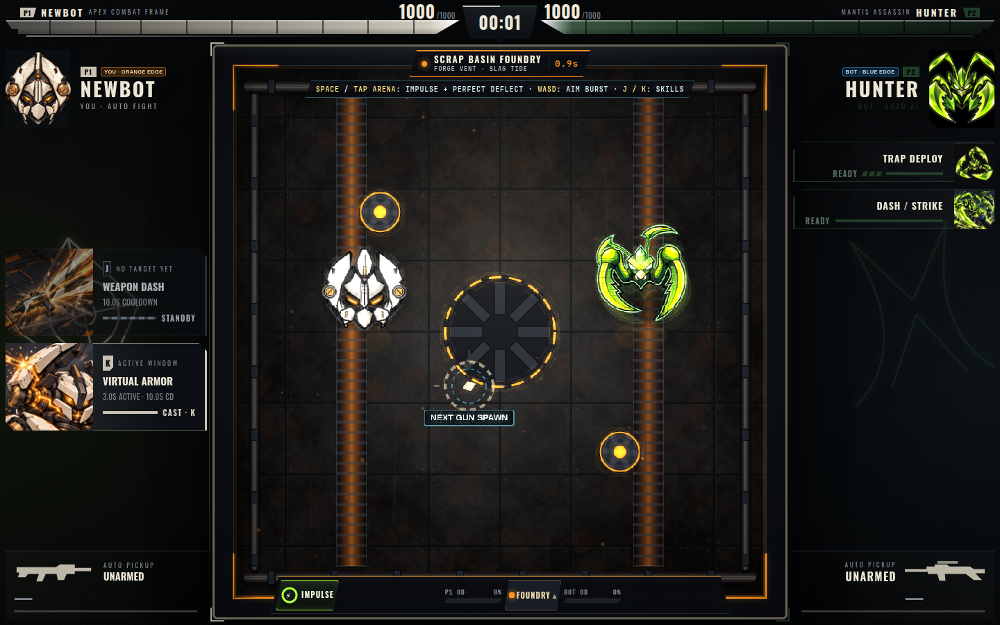

# APEX CHAOS

**Arena action. Distinct fighters. Five battlefields.**

**[▶ Play APEX CHAOS on itch.io](https://realbae.itch.io/apex-chaos)**

<p align="center">
  
</p>

APEX CHAOS is a top-down HTML5 action game with BOT Battle, Local 1v1 and BOT WAVE. Combat includes character-specific skills, arsenal weapon pickups and five Total Evolution arenas: Scrap Basin Foundry, Cryo-Turbine Vault, Lorentz Railyard, Obsidian Prism Sanctum and APEX Tournament Pro. The game runs in desktop and mobile browsers. The public build is **guest-first**.

## Gameplay preview

<p align="center">
  
</p>

## This branch contains only the shipping game and its minimum build inputs

| Directory | Why it remains |
| --- | --- |
| `src/` | Active React application, game integration, runtime loader, local account and localization |
| `public/apexEngine.js`, `public/game/` | Live combat, modes and arena runtimes |
| `public/assets/`, `public/gold/`, `public/bot-wave/` | Production art, sound, Gold interface and BOT WAVE |
| `public/portrait-studio.html` | Live owner capture/recording route |
| `gold-mission-account/`, `result-gold/` | Isolated Gold interfaces compiled into the game |
| `tools/` | Eleven build/packaging scripts used by the runtime source delivery |
| Root configuration | Dependency lock, Vite, entry HTML, ignore rules and this README |

The `public/` tree retains distribution-required font/asset license notices. This is editable **runtime source**, not a prebuilt ZIP. All historical visual donors, original art source packs, QA scripts, CI definitions, test fixtures, experiments and inactive backend migrations are stored on the archive branch, not in `main`.

## Develop or build

Requires Node.js 22 and pnpm 9.15.9. The two isolated Gold projects install their pinned npm dependencies automatically.

```bash
corepack enable
pnpm install --frozen-lockfile
pnpm dev
```

Use the local Vite URL printed in the terminal for development, not as a public play link.

```bash
pnpm build
pnpm package:itch
```

`pnpm build` compiles the production game into `dist/`; `pnpm package:itch` builds again and creates the nested-path-compatible `dist-itch-html5/` copy with its Git SHA receipt. Zip the **contents** of `dist-itch-html5/` (with `index.html` at ZIP root) and upload as an itch.io HTML5 project. Pushing a GitHub commit never updates itch.io automatically.

Use `pnpm preview` to preview an existing web build.

## Archived development and recovery

**[Full snapshot before strict runtime-only cleanup](https://github.com/Khanh-glitch/APEX-CHAOS/tree/archive/main-before-runtime-only-20261117)**

The archive contains canonical Gold design sources, legacy experiments, historical assets, QA evidence, workflows, original SFX/graphics source, test fixtures and inactive cloud migrations. `main` retains the integrated production Gold output in `public/gold/`; rebuild original Gold from archive if a future design cutover is necessary.

Repository cleanup does **not** claim a gameplay, balance or FPS improvement. Prior gameplay QA debt remains recorded in [issue #131](https://github.com/Khanh-glitch/APEX-CHAOS/issues/131).

## Rights

APEX CHAOS is an independent game project. Public source visibility does not grant permission to reuse or commercially redistribute the game, code, characters or assets. Third-party materials remain subject to their respective licenses.
