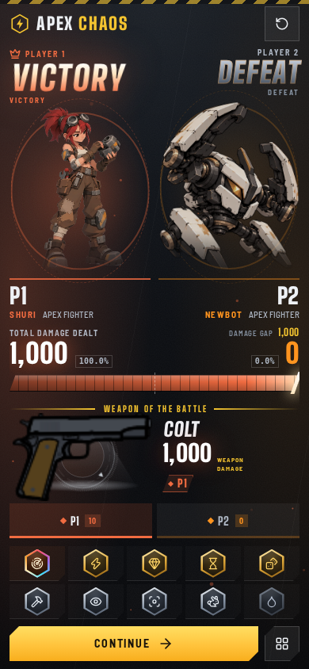
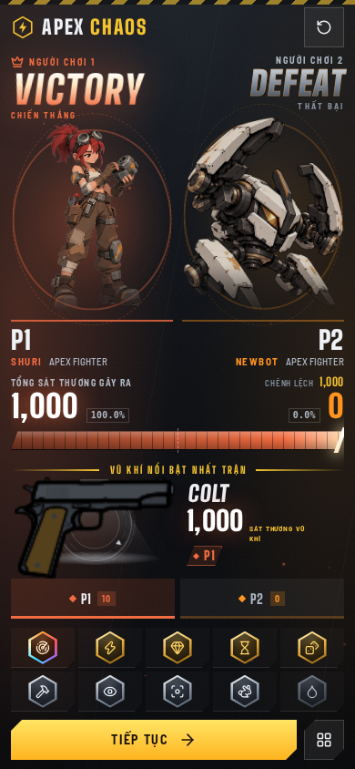
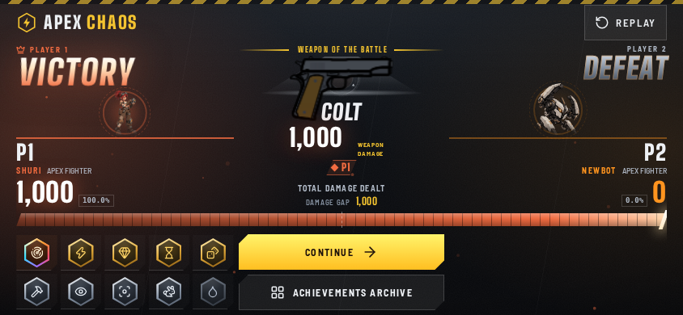
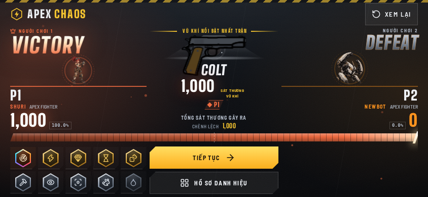
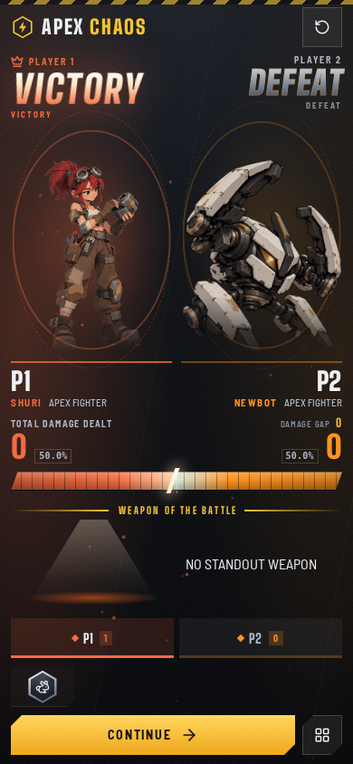

# RA-2 Final Acceptance Candidate

**Date:** 2026-10-22
**PR:** [#101](https://github.com/Khanh-glitch/APEX-CHAOS/pull/101) — still **Draft / Open**
**Branch:** `arena/d7ff52e8-apex-chaos`
**Reviewed runtime source SHA:** `cfa70c1417dfa7c055c36980fbda7fbca3ac4fe5`
**Latest completed PR-check head:** `4f3cc83592832684951c11f39c8b8cb387255b94` (documentation/evidence-only follow-up; no runtime source change)
**Candidate state:** exact-SHA isolated preview and requested RA-2 browser suites passed. This is not an owner acceptance or final technical verdict.

## Exact-SHA isolated preview

- **Workflow:** [RA-2 Exact-SHA Isolated Preview #101, run 39779363007](https://github.com/Khanh-glitch/APEX-CHAOS/actions/runs/39779363007) — **PASS**.
- **Direct deployment URL:** [https://b1278e89.apex-chaos.pages.dev](https://b1278e89.apex-chaos.pages.dev)
- **Stable per-commit branch URL:** [https://ra2-exact-cfa70c1417df.apex-chaos.pages.dev](https://ra2-exact-cfa70c1417df.apex-chaos.pages.dev)
- Cloudflare served the exact commit/revision receipt. The served Gold shell and selected UI-SFX runtime matched the local build bytes. The production receipt before and after the isolated deploy was unchanged.
- Remote Chromium acceptance passed for Field Archive, progressed Mastery, Lucky Draw, Result Gold, and tutorial lifecycle. The Cloudflare deployment was isolated; no production deploy or itch publication occurred.
- [Workflow artifact / remote evidence](https://github.com/Khanh-glitch/APEX-CHAOS/actions/runs/39779363007) (`ra2-exact-preview-cfa70c1417dfa7c055c36980fbda7fbca3ac4fe5-evidence`).

## Local gates and acceptance evidence

- Gold revision integrity: **18/18**; transition coordinator: **65/65**; Gold shell loader: **9/9**.
- Production build and shipping audit: **480** shipping files, **0** non-shipping leaks, **0** forbidden manifest entries; CP16 receipt records this candidate SHA and 70 versioned runtimes.
- Localization contract: **522** curated phrases, 26 proper names, 13 dialogue lines; ENG/VIE text and accessible attributes restore.
- Lucky Draw disposable-profile state matrix: **24/24**; insufficient, pending, generic-error, successful ENG/VIE paths, exact debit/ownership, duplicate-input refusal, and reload persistence. No draw/economy authority change.
- Progressed Mastery: **16/16**; Field Archive dossier coverage: all **14 fighters** and **41 weapons**, zero curated dynamic-copy mismatches.
- Result Gold: ENG/VIE portrait and landscape; zero-damage/no-weapon fallback; archive/detail and locked Codex; art matrix **56/56**, four-viewport browser matrix with zero failures. No redesign or new art correction.
- Tutorial lifecycle: **19/19**; packaged nested `/html/apex/` host: **15/15**, including the real paused Skill 1 lesson, nested SKIP persistence, and pause release.

### Result Gold screenshots

| ENG — portrait | VIE — portrait |
|---|---|
|  |  |

| ENG — landscape | VIE — landscape |
|---|---|
|  |  |

| ENG — zero-data | VIE — zero-data |
|---|---|
|  |  |

### Additional ENG/VIE evidence

- Lucky Draw state screenshots: [insufficient ENG](evidence/lucky-draw/insufficient-eng.png), [insufficient VIE](evidence/lucky-draw/insufficient-vie.png), [success ENG](evidence/lucky-draw/success-eng.png), [success VIE](evidence/lucky-draw/success-vie.png), [error ENG](evidence/lucky-draw/error-eng.png), [error VIE](evidence/lucky-draw/error-vie.png).
- Field Archive localization: [desktop ENG](evidence/localization/desktop-archive-eng.png), [desktop VIE](evidence/localization/desktop-archive-vie.png), [mobile VIE](evidence/localization/mobile-portrait-archive-vie.png).
- Lucky Draw localization: [desktop ENG](evidence/localization/desktop-lucky-draw-eng.png), [desktop VIE](evidence/localization/desktop-lucky-draw-vie.png), [mobile VIE](evidence/localization/mobile-portrait-lucky-draw-vie.png).
- Nested tutorial pause lesson: [390×844 evidence](evidence/tutorial/nested/nested-tutorial-paused-390x844.png).

## Current PR checks

At the latest fully completed PR-check snapshot, head `4f3cc83592832684951c11f39c8b8cb387255b94` (documentation/evidence-only above the runtime SHA), GitHub reports **22 pass, 2 fail, 0 pending**. R77, Result Gold, A1 browser acceptance, BOT WAVE, cosmetic-contract, full-frost-contract, Story lock, and the isolated exact-SHA Cloudflare workflow passed. The separate push-triggered Arsenal Product Acceptance run [39789396947](https://github.com/Khanh-glitch/APEX-CHAOS/actions/runs/39789396947) also passed.

Two PR check failures remain unwaived: [`actual-preview-entrypoint`](https://github.com/Khanh-glitch/APEX-CHAOS/actions/runs/39789412627), the deployed Netlify START URL verification, and [Arsenal Product Acceptance run 39789412644](https://github.com/Khanh-glitch/APEX-CHAOS/actions/runs/39789412644), which failed at “Run product-authentic Arsenal headless acceptance.” The failure’s cause has not been established; the attempted Actions log download returned EOF, and no causal connection to the RA-2 documentation-only commits has been established. The isolated Cloudflare preview is independently verified and does not replace the Netlify check. No assertions were weakened; reproduce and measure before any fix, and do not redesign or expand scope.

## Unverified / limits

- No physical iPhone/Safari or Android device testing; browser evidence is Chromium emulation.
- The integrated compatibility matrix is local-source evidence; the exact-SHA workflow covers the requested RA-2 suites, not every compatibility profile.
- The independent Netlify START entrypoint and Arsenal Product Acceptance headless-step failures remain unresolved; no cause or relationship to RA-2 has been established.
- **RA-2 technical verdict: NOT ISSUED.** No `READY`, `CONDITIONAL`, or `OWNER ACCEPTED` status is claimed. PR #101 remains Draft/Open; no merge, production deployment, or itch publication occurred.
