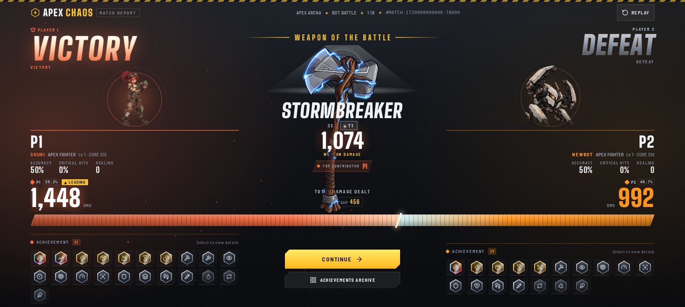
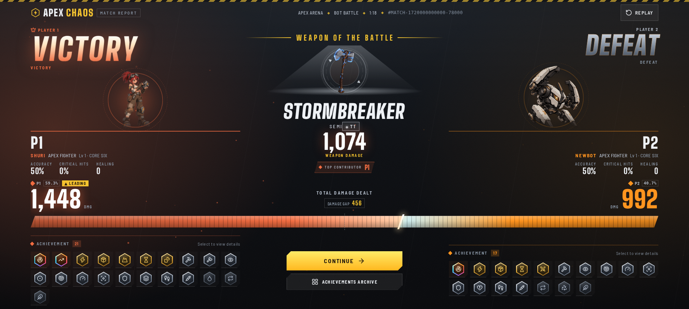

# PR #101 — RA-2 Release Blocker A/B Evidence

**State:** implementation candidate pushed; PR remains Draft/Open. No production deployment, merge, owner acceptance, or scope expansion.

- **Baseline source SHA:** `4a12ac309f2b81202c5e0d292e48d7be4dbde28a`
- **Fixed implementation source SHA:** `49ca23c6814a47160516dbf9fdaccab2cdf8a767`
- **Screenshot scale:** device scale factor 1; dimensions are browser viewport pixels.
- Full image SHA-256 values and measurements are indexed in [`ab-evidence-manifest.json`](ab-evidence-manifest.json).

## Result — canonical sealed scenario

P1 SHURI victory vs. P2 NEWBOT defeat; 1,448 vs. 992 damage; 21 vs. 17 awards; STORMBREAKER; 78 seconds. The fixed version uses the same sealed authority and approved art.

| Regression | Before | After |
|---|---:|---:|
| Matrix checks across ENG/VIE and 1844×829, 1440×900, 1560×992, 844×390, 390×844 | 59/82 (23 failures) | **82/82 (0 failures)** |

**Primary 1844×829 ENG pair**

| Before | After |
|---|---|
|  |  |

Matching settled screenshots are recorded for **both ENG and VIE** at all five viewport sizes. See [`result-before/`](result-before/) and [`result-after/`](result-after/); every pair is listed with dimensions and hashes in the manifest.

## Mastery — progressed owner profile

550 AC; 21/252 total; eight recent unlocks; NEWBOT 21/42; OFFENSE expanded; live ENG → VIE → ENG switching.

| Regression | Before | After |
|---|---:|---:|
| Localized display/aria and immutable profile checks | 4/10 (6 failures) | **10/10 (0 failures)** |

- ENG A/B: [`before`](mastery-before/progressed-550ac-21of252-newbot-21of42-eng-offense-1440x900.png) · [`after`](mastery-after/progressed-550ac-21of252-newbot-21of42-eng-offense-1440x900.png)
- VIE A/B: [`before`](mastery-before/progressed-550ac-21of252-newbot-21of42-vie-offense-1440x900.png) · [`after`](mastery-after/progressed-550ac-21of252-newbot-21of42-vie-offense-1440x900.png)

## Achievement toast — `steady-hand` vs. K / VIRTUAL ARMOR

| Regression | Before | After |
|---|---:|---:|
| P1/P2, provisional/sealed, locale, HUD geometry, wallet/mastery immutability | 30/40 (10 failures) | **40/40 (0 failures)** |

- ENG P1 provisional, 844×390 A/B: [`before`](toast-before/steady-hand-eng-844x390-provisional.png) · [`after`](toast-after/steady-hand-eng-p1-provisional-844x390.png)
- At 1844×829 the card finds a safe visible dock and does not intersect gameplay HUD rectangles. At 320×568, 844×390, and 1024×768 there is no safe toast rectangle, so its visual card is suppressed while `role=status` / `aria-live=polite` semantics remain available.

## Reproduction reports

- [Result baseline](result-before/result-overlap-report.json) · [Result fixed](result-after/result-overlap-report.json)
- [Mastery baseline](mastery-before/mastery-localization-report.json) · [Mastery fixed](mastery-after/mastery-localization-report.json)
- [Toast baseline](toast-regression/toast-layout-report.json) · [Toast fixed](toast-after/toast-layout-report.json)

Only the three requested defects were addressed: Result art/text overlap, Mastery achievement-name localization, and toast overlap with skills. Gameplay/economy/entitlement/award authority and unrelated visual items were not changed.
