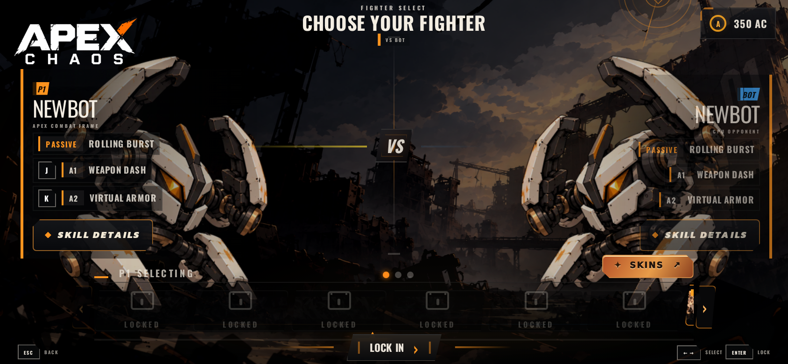
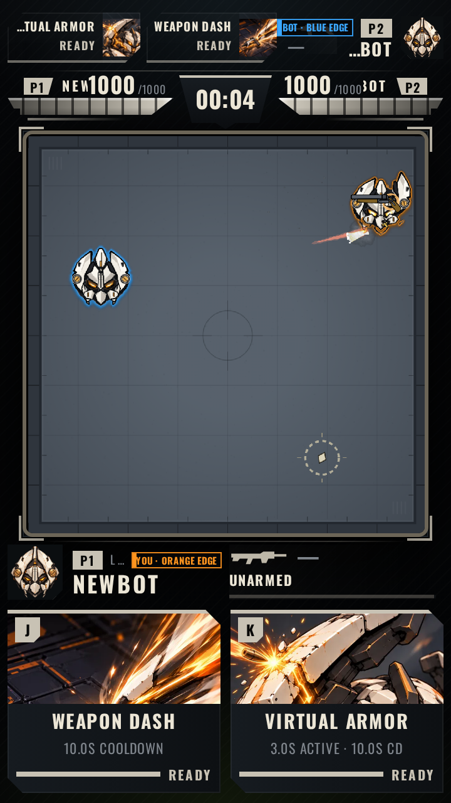
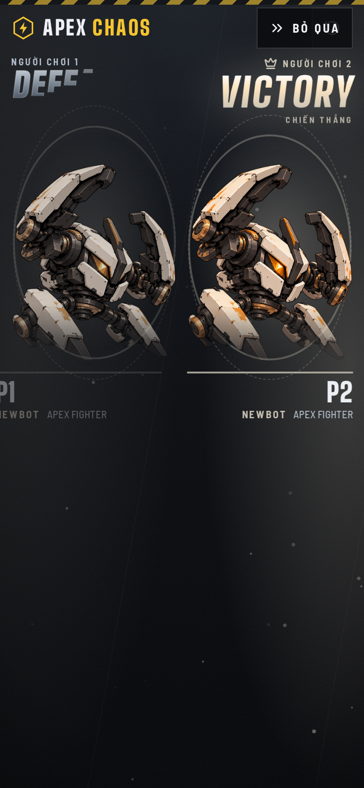
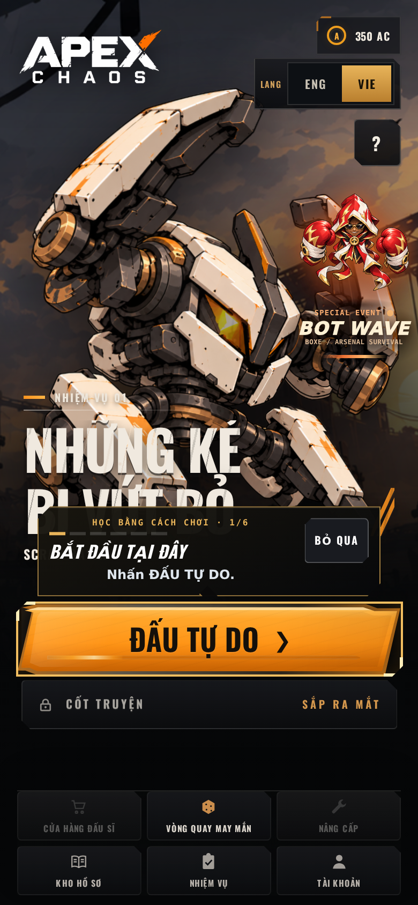
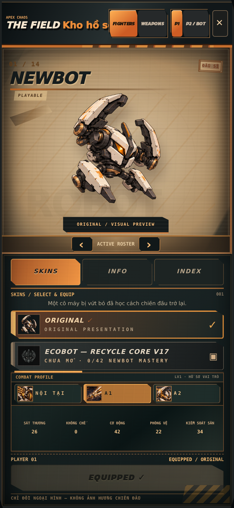

# APEX CHAOS — Audit sẵn sàng phát hành (2026-10-22)

**Đối tượng audit:** bản ứng viên trên nhánh hiện tại, commit `5282d80f47809f8d4bfaba4b2bbf03c03885c346`
(revision `20261021-cp5-r1`), chính là bản đang chạy tại
https://cp53-playtest-5282d80.apex-chaos.pages.dev
**Lưu ý quan trọng:** production `apex-chaos.pages.dev` vẫn là bản A1 cũ
(`c7a04f0b…/20261020-a1-r20`). Mọi kết luận dưới đây nói về **bản ứng viên**, chưa phải bản người chơi thật đang nhận.

## Phương pháp & giới hạn

- **Đo thực tế** bằng Chromium headless trên bản build của đúng commit trên: 5 cấu hình
  (360×640, 390×844, 844×390, 768×1024, 1280×720) × ENG/VIE, đi đường thật
  Home → Mode → Fighter → Battle → Result, đo tràn ngang, chữ bị cắt, phần tử ngoài
  viewport, lỗi console, request hỏng, host ngoài, trạng thái font.
- **Đọc code** toàn bộ `src/`, `public/game`, Gold shell/battle-HUD, hệ i18n, font, đóng gói itch, chính sách phát hành.
- **Giới hạn:** chưa có thiết bị thật (iOS Safari/Samsung Internet/máy Android yếu chưa kiểm),
  chưa đo FPS phần cứng thật, chưa chơi dài hạn nhiều giờ. Các mục này được gắn nhãn
  **[CẦN KIỂM CHỨNG]** thay vì kết luận.
- Nhãn bằng chứng: **[ĐO]** = số liệu/ảnh chụp trong đợt này · **[CODE]** = đọc mã nguồn · **[CẦN KIỂM CHỨNG]** = chưa đủ bằng chứng kết luận.
- Nhãn mức độ: **[CHẶN]** nên xử lý trước phát hành · **[NẶNG]** · **[TRUNG BÌNH]** · **[NHẸ]**.

Ảnh bằng chứng nằm trong `docs/audit/assets/`.

---

## Tóm tắt điều hành — 5 việc đứng đầu

1. **[CHẶN] Font chữ lớn tiếng Việt bị vỡ dấu ở màn hình Home** — "NHỮNG KẺ BỊ VỨT BỎ"
   hiển thị méo thành dạng đọc như "PI VỨT PỎ". Đây là ấn tượng đầu tiên của người chơi Việt. (C1)
2. **[CHẶN — cần quyết định kiến trúc] Đường vào trên điện thoại đang chia 3 ngả khác nhau**
   (khung "Gold Fidelity Laboratory" / native trong iframe itch / desktop). Chưa ngả nào
   được kiểm chứng đầy đủ ở mọi tư thế máy. (A1, A2, A3)
3. **[NẶNG] Xoay ngang điện thoại: dải chọn tướng nằm ngoài màn hình** — không đổi tướng được. (A2)
4. **[NẶNG] Field Archive tiếng Việt lẫn ~50% tiếng Anh**, tiêu đề song ngữ thừa và bị cắt. (D1)
5. **[NẶNG] Thanh HUD trên cùng trong trận ở điện thoại cắt tên cả hai đấu sĩ** ("NEW" / "…BOT"),
   tên đối thủ không đọc được. (B1)

Và điểm nghẽn quy trình lớn nhất: **production vẫn là A1** — toàn bộ CP3.2 → CP5.3 chưa được
merge/phát hành (I1). Mọi sửa chữa gần đây người chơi thật chưa nhận được.

---

## A. Tương thích thiết bị & khung hình

### A1. [CHẶN] Ba đường vào khác nhau cho cùng một game [ĐO][CODE]
`index.html` chứa script chuyển hướng: thiết bị cầm tay (UA iPhone/iPad/Android/iPad-giả-Mac)
mở trang chủ sẽ bị đưa sang `/gold-fidelity-lab.html` — một khung iframe co giãn "không gian
thiết kế Gold" theo hồ sơ thiết bị (R91, **chưa được owner duyệt hình ảnh** theo luật hiện hành).
Hệ quả thực tế có **ba biến thể** đang tồn tại song song:
- **Điện thoại vào thẳng web:** chạy trong khung Lab (đo: 390×844 không letterbox, tương tác được;
  xoay ngang 844×390: không gian thiết kế 952×440 thu nhỏ ~0.886).
- **Điện thoại chơi trên itch.io:** game nằm trong iframe của itch → điều kiện chuyển hướng
  `window.top === window` không thỏa → chạy **native** (chính là biến thể có lỗi A2).
- **Desktop:** native.
Chưa biến thể nào được kiểm chứng chéo đầy đủ. Kèm theo: **tiêu đề tab của người chơi điện thoại
là "APEX CHAOS — Multi-Profile Gold Fidelity Laboratory"** và URL chứa `gold-fidelity-lab` —
chữ "Laboratory" (phòng thí nghiệm) lộ ra sản phẩm thật.
**Khuyến nghị:** owner quyết một kiến trúc duy nhất cho mobile trước phát hành; tối thiểu đổi
title/URL cho sạch thương hiệu; kiểm chứng riêng biến thể itch (vì đó là kênh phát hành chính).

### A2. [NẶNG] Native xoay ngang (844×390): dải chọn tướng ngoài màn hình [ĐO]

Ở chiều cao 390px, ảnh lớn + bảng kỹ năng chiếm hết chiều cao; dải thẻ tướng bị đẩy xuống dưới
mép màn hình (chỉ còn hàng nhãn "LOCKED" ló lên), nút LOCK IN sát mép dưới còn 3px
(đo: `bottom=387/390`). Người chơi vẫn LOCK IN được tướng mặc định nhưng **không chọn/đổi tướng khác được**.
Ba lần chạy tự động theo đúng luồng dọc đều không tới được trận ở tư thế ngang.
**Khuyến nghị:** hoặc sửa layout ngang cho Fighter Select (thu gọn theo chiều cao), hoặc tuyên bố
chính thức "chơi dọc trên điện thoại" kèm màn hình nhắc xoay máy. Không nên để nguyên trạng mơ hồ.

### A3. [CẦN KIỂM CHỨNG] Khung Lab ở các tỉ lệ khác [ĐO một phần]
Đã đo 390×844 (khớp 1:1) và 844×390 (952×440). Chưa kiểm: máy dài 19.5:9/21:9, máy gập,
tablet, và việc dải chọn tướng có vừa trong 440px thiết kế khi ngang hay không.

### A4. [NHẸ] `user-scalable=no`, `maximum-scale=1.0`; `lang="en"` cố định [CODE]
Thông lệ với game nhưng là điểm trừ accessibility; thuộc tính `lang` không đổi theo ngôn ngữ VIE
(ảnh hưởng screen reader/SEO).

### A5. [CẦN KIỂM CHỨNG] Safari iOS, Samsung Internet, máy Android cấu hình thấp
Toàn bộ bằng chứng hiện có là Chromium. Cần ít nhất một vòng máy thật trước public.

---

## B. HUD/UI — chất lượng & độ đồng đều

### B1. [NẶNG] Thanh trạng thái trên cùng trong trận cắt chữ ở điện thoại [ĐO]

Ở 360–390px: tên P1 hiện "NEW" + "1000" dính liền, tên P2 hiện "…BOT", chip trạng thái kỹ năng
cắt thành "…TUAL ARMOR READY" (đo DOM: `id-name` cần 53px được cấp 36px; `sk-name` 72/64px).
Tên **đối thủ chỉ tồn tại ở thanh này** → trên điện thoại người chơi không đọc được mình đang đấu ai.
Đây là Gold Battle HUD (khu vực được bảo vệ theo luật owner) — cần một đợt sửa được duyệt riêng,
không tự ý đổi layout.

### B2. [TRUNG BÌNH] Nhãn điều khiển "LOCAL · TAP" / "LOCAL · J K" [ĐO][CODE]
`battle-hud.html` gán cứng nhãn này cho P1 trong **mọi chế độ kể cả đấu BOT**, không qua hệ dịch,
và trên điện thoại bị bóp còn "L…" (đo: được cấp 11–35px cho chuỗi cần 64px). Vừa gây hiểu lầm
("LOCAL" trong trận BOT), vừa là nhiễu thị giác vô nghĩa. Đề xuất tối thiểu: ẩn ở bố cục dọc chật
(đã có tiền lệ CSS ẩn cho quest/2P trong cùng file) hoặc rút gọn + đưa vào catalog dịch — cần owner duyệt vì thuộc HUD bảo vệ.

### B3. [CẦN KIỂM CHỨNG] Màn Kết quả: cột P1 nghi tràn mép trái ở 390px [ĐO một phần]

Ảnh chụp giữa chuyển động 6 pha cho thấy cột P1 bị cắt ("EWBOT", "P1" mất nửa). Lần chạy xác minh
trạng thái tĩnh không tới được Result (xem F1) nên **chưa kết luận** đây là lỗi layout hay chỉ là
khung hình giữa hiệu ứng trượt. Cần chụp lại sau khi nhấn BỎ QUA (nút có sẵn ✓) trước phát hành.

### B4. [NHẸ] Không nhất quán chữ viết tắt trên thẻ kỹ năng [ĐO]
Hai thẻ kề nhau: "10.0S COOLDOWN" và "3.0S ACTIVE · 10.0S CD". Thống nhất một kiểu.

### B5. [CẦN KIỂM CHỨNG] Huy hiệu phím J/K trong phiên cảm ứng [ĐO]
Trong mọi phiên giả lập cảm ứng của audit, thẻ kỹ năng vẫn hiện badge "J"/"K". Cần xác nhận trên
máy cảm ứng thật game có ẩn đúng không (biến `desk` trong battle HUD quyết định).

### B6. [NHẸ] Wordmark VICTORY/DEFEAT tiếng Anh + phụ đề tiếng Việt [ĐO]
Lựa chọn phong cách song ngữ nhất quán cả hai phía — ghi nhận để owner xác nhận là chủ đích, không xếp lỗi.

---

## C. Font & typography

### C1. [CHẶN] Headline tiếng Việt vỡ dấu [ĐO]

Dòng chữ lớn nhất của game — "NHỮNG KẺ BỊ VỨT BỎ" — hiển thị với dấu thanh/dấu phụ đặt sai vị trí
(đọc thành "PI VỨT PỎ"). Chữ thân bài tiếng Việt (chip hướng dẫn, nút) hiển thị đúng, nên lỗi nằm ở
**font hiển thị cỡ lớn**: bộ font nạp sẵn chỉ có Oswald subset latin/latin-ext + Teko latin/latin-ext —
**không font nào có subset tiếng Việt đúng nghĩa**; ký tự Việt rơi vào fallback từng ký tự với metric lệch.
Bản sửa đúng hướng hệ thống: cho headline tiếng Việt dùng `ApexVietCondensed` (đã có cho các frame)
hoặc bổ sung Oswald subset `vietnamese` dạng woff2 — không vá từng màn hình.

### C2. [TRUNG BÌNH] Nhiều họ chữ, có tham chiếu chết [CODE]
Đang lưu hành tối thiểu: Oswald, Teko, ApcKanit, Montserrat (900), JetBrains Mono, ApexVietCondensed.
Stack `Rajdhani, Teko, …` tham chiếu Rajdhani **không hề được nạp** (âm thầm fallback). Số họ chữ lớn
không sai tự thân, nhưng là rủi ro đồng đều: mỗi surface một "giọng" chữ khác nhau nếu không có thang chữ chung được tuân thủ.

### C3. [NHẸ] Font Việt dạng TTF 172KB chưa subset [CODE]
`apex-oswald-vietnamese.ttf` nặng hơn nhiều so với các woff2 subset 8–21KB còn lại.

---

## D. Ngôn ngữ & bản địa hoá

### D1. [NẶNG] Field Archive (Kho hồ sơ) lẫn Anh–Việt ~50% [ĐO]

Chưa dịch: FIGHTERS, WEAPONS, PLAYABLE, ORIGINAL / VISUAL PREVIEW, ACTIVE ROSTER, SKINS, INFO,
INDEX, SKINS / SELECT & EQUIP, ORIGINAL PRESENTATION, COMBAT PROFILE, EQUIPPED, "NEWBOT MASTERY"
(thuật ngữ Anh xen câu Việt). Tiêu đề thành song ngữ thừa **"THE FIELD Kho hồ sơ"** và bị tab cắt mất chữ.
Đây là tồn đọng đã biết từ CP4; đợt này có bằng chứng mới kèm lỗi cắt tiêu đề.

### D2. [TRUNG BÌNH] Các đảo tiếng Anh còn lại [ĐO][CODE]
Banner "SPECIAL EVENT / BOT WAVE / ARSENAL SURVIVAL" ở Home không dịch; nút "SKINS" ở Fighter Select
giữ tiếng Anh mọi ngôn ngữ; nhãn B2. Tên riêng (BOT WAVE, SCRAP BASIN, tên tướng) giữ nguyên là đúng luật —
phần cần dịch là các mô tả chức năng.

### D3. [TRUNG BÌNH] Cơ chế dịch khớp chuỗi dễ sót, chưa có cổng kiểm tra [CODE]
Hệ dịch DOM dùng catalog 278 cặp khớp nguyên văn; copy đổi một ký tự là âm thầm rơi về tiếng Anh
(không cảnh báo). Đề xuất thêm một gate tự động: chạy phiên VIE, quét text node còn tiếng Anh ngoài
danh sách tên riêng cho phép.

### D4. [NHẸ] Nhất quán thuật ngữ [ĐO]
"MASTERY" (Archive) vs "Tinh thông" (Missions); "PLAYER 01"/"EQUIPPED" trong cùng màn đã dịch một nửa.
Chốt một bảng thuật ngữ VIE duy nhất.

---

## E. Mật độ nội dung ("rừng chữ")

### E1. [TRUNG BÌNH] Battle HUD trùng lặp thông tin P1 hai nơi [ĐO]
Thanh trên và panel dưới cùng hiện tên/HP/trạng thái của P1; tổng ~116 nút chữ đang hiển thị trong trận,
trong khi nơi chật nhất (thanh trên) lại là nơi bị cắt chữ (B1). Khi được duyệt đợt HUD, nên xét lại
vai trò từng lớp: thanh trên chỉ nên giữ thứ panel dưới không có (đối thủ + đồng hồ).

### E2. [NHẸ] Home nhiều lớp chữ trang trí chồng nhau [ĐO]
Nhãn địa điểm "SCRAP BASIN" bị chip hướng dẫn che một phần ở lần chơi đầu; banner nhiệm vụ bị đo
tràn hộp chữ (217px nội dung trong hộp 135px ở desktop — mắt thường chưa thấy cắt ký tự, cần rà soát);
nút "?" không nhãn ở góc phải khiến người mới không biết bấm vào là gì (xem thêm F2).

### E3. [CẦN KIỂM CHỨNG] Tính trung thực của các lối vào chưa mở [CODE]
Home có CỬA HÀNG ĐẤU SĨ và NÂNG CẤP trong khi nội dung catalog ghi "Fighter Shop is not open yet".
Chưa kiểm trong đợt này trạng thái khi chạm vào (phải là khóa + thông báo trung thực theo luật sản phẩm).
CỐT TRUYỆN hiển thị khóa "SẮP RA MẮT" ✓ đúng chuẩn.

---

## F. UX & luồng chơi

### F1. [TRUNG BÌNH] Độ dài trận tự đánh biến thiên rất lớn; chưa xác minh luật hết giờ [ĐO]
Hai trận gương NEWBOT không can thiệp: một trận kết thúc sau **106 giây**, một trận **quá 220 giây vẫn
chưa phân thắng bại**. Đồng hồ trận đếm tiến (00:02, 00:04…). Audit chưa xác minh được luật xử thắng
khi hết giờ/giới hạn thời gian tối đa. Nếu không có trần, trận hai BOT "rùa" (sustain) có thể kéo dài
khiến người chơi chờ đợi mơ hồ. Cần xác minh + nếu chưa có, bổ sung luật hết giờ và hiển thị đồng hồ đếm ngược.

### F2. [NHẸ] Nút "?" không nhãn; không hướng dẫn xoay máy [ĐO]
Người mới không có gợi ý nút "?" là gì; khi xoay ngang vỡ layout (A2) cũng không có thông điệp nào.

### F3. [Ghi nhận tốt] Onboarding hiện tại [ĐO]
Coach từng bước + chip nhận diện đầu trận (CP5.3) hiển thị rõ, màu khớp viền BOT thật trong mọi ảnh đo;
nút BỎ QUA ở Result và SKIP hướng dẫn đều có.

---

## G. Bug & độ ổn định

### G1. [Ghi nhận tốt — đã đo] Vệ sinh runtime rất tốt
7 phiên đo: **0 lỗi console, 0 request hỏng/404, 0 host ngoài** (không rò mạng — đúng cam kết Guest),
tràn ngang cấp trang = 0 ở mọi viewport (gồm Missions sau sửa CP5.2). console.log trong code: 2 chỗ;
TODO/FIXME thực chất: ~0.

### G2. [TRUNG BÌNH] Không thấy ErrorBoundary / màn hình lỗi thân thiện ở lớp React [CODE]
Chỉ `runtimeLoader` bắt lỗi nạp runtime. Một lỗi render bất ngờ có nguy cơ trắng màn hình không thông điệp,
không đường khôi phục cho người chơi. Đề xuất tối thiểu: boundary + màn hình "đã xảy ra lỗi, chạm để tải lại"
(không mất save vì save nằm ở localStorage có fallback — phần lớn điểm đọc save đã có try/catch ✓).

### G3. [CẦN KIỂM CHỨNG] Hành vi khi ẩn tab/chuyển app, nút Back trình duyệt, mất mạng giữa chừng
Chưa kiểm trong đợt này; với game iframe (itch/Lab) đây là các tình huống hay gặp.

---

## H. Hiệu năng & dung lượng

### H1. [NẶNG cho kênh web] Gói phát hành 78MB / 533 file [ĐO]
`dist` 78MB (nguồn `public/` 250MB). File nặng nhất: nhiều PNG 2–3MB (art dictionary BOXE),
`menu_bgm.mp3` 3.1MB, JS hiệu ứng cửa 2.6MB. Điểm vào nhẹ (index 1.5KB + JS chính ~478KB + shell ~438KB)
và có nạp trễ theo surface — nhưng tổng tải khi chơi sâu vẫn lớn cho người dùng mạng yếu/di động.
Đề xuất: chuyển PNG art nặng sang WebP/AVIF (repo đã có 499 WebP — còn 257 PNG), đặt ngân sách
"tải lần đầu tới khi bấm được START" và đo trên 4G giả lập.

### H2. [CẦN KIỂM CHỨNG] FPS trên máy yếu
Hiệu ứng viền phe dùng compositing offscreen từng khung hình (đã từng A/B FPS ở CP3 trên máy bàn).
Chưa có số liệu GPU di động giá rẻ.

### H3. [NHẸ] 198 file âm thanh (155 mp3 + 43 ogg) [ĐO]
Bank SFX UI 18 key đã chuẩn hoá một authority ✓; nên rà soát trùng lặp/dung lượng ở tầng nhạc nền & hero SFX.

---

## I. Phát hành & vận hành

### I1. [NẶNG] Production tụt lại nhiều đợt so với nhánh [ĐO]
`apex-chaos.pages.dev` = A1 (`c7a04f0b`). CP3.2, CP4, CP5→CP5.3 (mastery, tutorial pause, side identity,
toast, Missions dọc…) đều chưa tới tay người chơi. Trước public cần một kế hoạch nghiệm thu → merge → deploy
theo đợt có kiểm chứng, không dồn một lần.

### I2. [TRUNG BÌNH] Metadata chia sẻ còn trống [CODE]
`index.html` không có meta description, Open Graph/Twitter card, theme-color (trang result-gold thì có).
Link game khi chia sẻ sẽ trống trơn; thêm ảnh OG + mô tả song ngữ là việc rẻ, hiệu quả cao.

### I3. [TRUNG BÌNH] Không hiển thị phiên bản trong game [CODE]
Có `CP16_BUILD_RECEIPT.json` nhưng ẩn. Người chơi báo lỗi sẽ không biết nói mình ở bản nào.
Đề xuất hiện revision nhỏ trong Account/Settings.

### I4. [NHẸ] Tín hiệu CI chưa sạch [CODE]
CI 24/25 với một check Netlify chết cố hữu (`actual-preview-entrypoint` — site preview không tồn tại).
Nên sửa hoặc gỡ để "đỏ" luôn có nghĩa trước phát hành.

### I5. [NHẸ] Credits/giấy phép [CODE]
File OFL cho font Oswald có kèm ✓. Chưa thấy surface credits cho audio/art trong game — rà soát trước public.

### I6. [Ghi nhận tốt] Chính sách Guest được khóa cứng đúng luật [CODE][ĐO]
`GUEST_ONLY_RELEASE = true` cố định trong code, admin fail-closed, đo thực tế 0 cuộc gọi mạng ngoài.
Mã cloud (Supabase) chỉ lazy-import sau cổng release — trước public nên xác nhận thêm một lần ở bản dựng cuối.

---

## Lộ trình khuyến nghị (thứ tự xử lý)

| # | Việc | Hạng mục | Ghi chú |
|---|------|----------|---------|
| 1 | Sửa font headline tiếng Việt (dùng ApexVietCondensed/Oswald-vietnamese cho VIE display) | C1 | Nhỏ, tác động lớn nhất |
| 2 | Owner quyết kiến trúc mobile (Lab vs native) + dọn title/URL "Laboratory"; kiểm chứng biến thể itch | A1 | Quyết định sản phẩm |
| 3 | Xử lý xoay ngang: sửa layout Fighter Select theo chiều cao **hoặc** khóa dọc + màn nhắc xoay | A2 | Blocked bởi #2 một phần |
| 4 | Dịch nốt Field Archive + sửa cắt tiêu đề; chốt bảng thuật ngữ; thêm gate quét sót dịch | D1, D3, D4 | Thuần nội dung |
| 5 | Đợt HUD được duyệt: thanh trên đọc được ở điện thoại + xử lý nhãn LOCAL · TAP | B1, B2, E1 | Khu vực bảo vệ — cần duyệt |
| 6 | Xác minh Result trạng thái tĩnh + luật hết giờ trận đấu | B3, F1 | Kiểm chứng trước, sửa sau nếu có |
| 7 | Metadata/OG, hiển thị phiên bản, credits, ngân sách tải (WebP hoá PNG nặng) | I2, I3, I5, H1 | Việc rẻ, làm song song |
| 8 | ErrorBoundary + kiểm các tình huống ẩn tab/Back/mất mạng | G2, G3 | Ổn định |
| 9 | Nghiệm thu theo đợt CP3.2→CP5.3 rồi merge/deploy production | I1 | Điểm nghẽn cuối |

**Kết luận một câu:** nền kỹ thuật (ổn định, kỷ luật tràn, không rò mạng, hệ gate) đã ở mức phát hành được;
thứ đang cản là **hoàn thiện bề mặt** — font tiếng Việt, tính nhất quán ngôn ngữ/HUD trên điện thoại,
một quyết định kiến trúc cho mobile, và việc đưa các đợt đã làm xong ra production.
