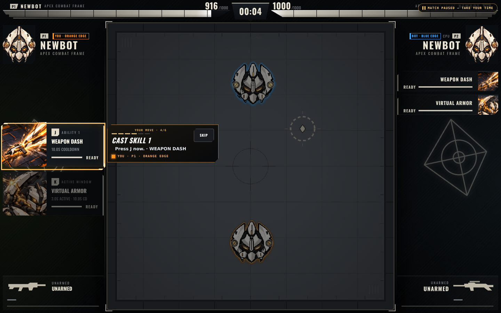
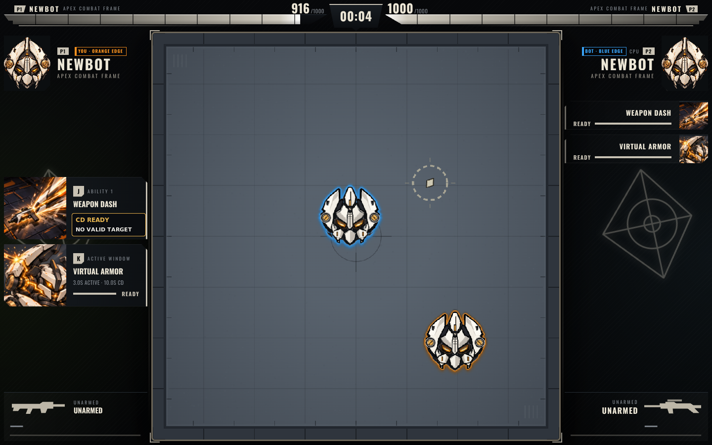
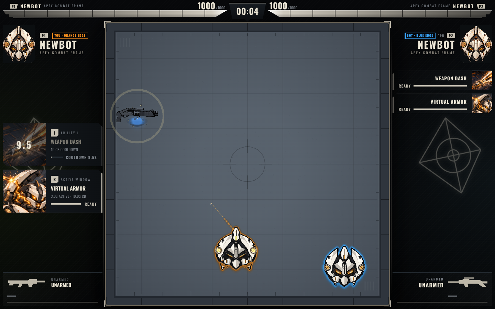
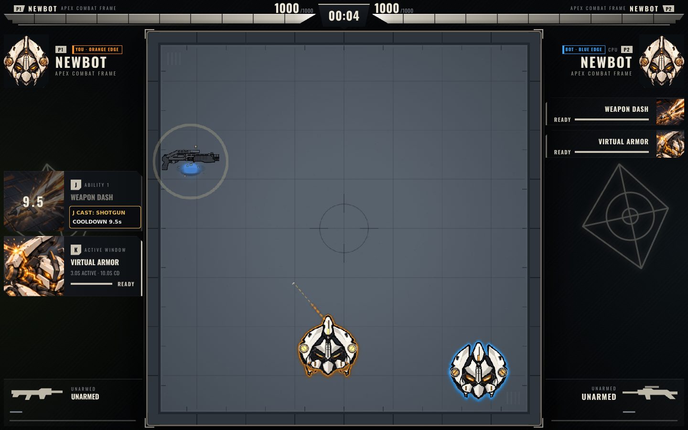
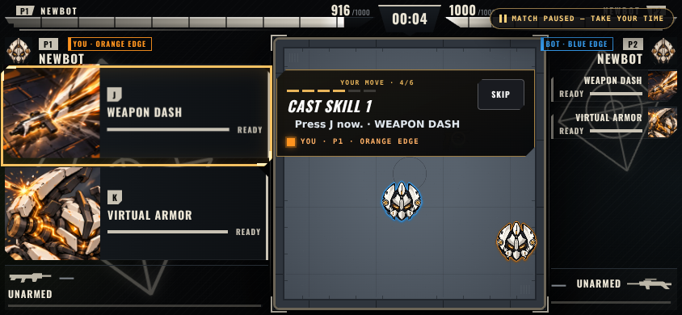
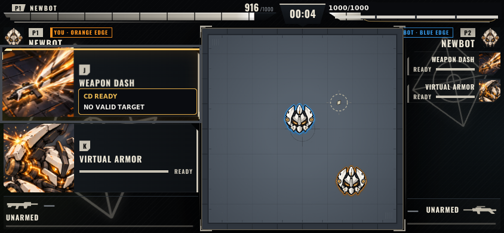
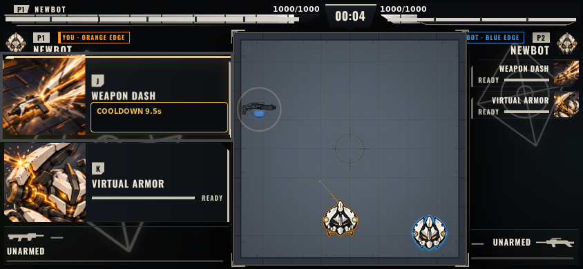
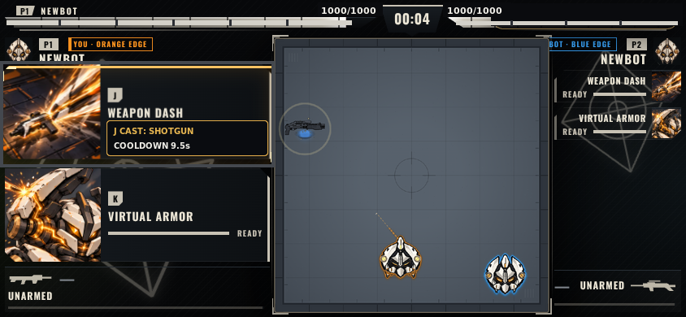
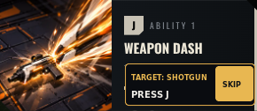
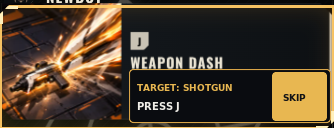

# APEX CHAOS — Active HUD UX Refinement

**Revision 2 · owner-review concept only · not implemented or approved.** This iteration replaces the rejected prior B: it retains the existing Gold battle HUD/arena and changes only contextual J-state presentation. No application source, game rules, cooldowns, targeting, damage, VFX, economy, Result UI, or production behavior changed.

## Desktop A/B — 1440×900

### J cooldown ready, but no eligible target

| A — live evidence | B — static concept |
|---|---|
|  |  |

A is the live first-play frame where “Press J now” appears while P1 is UNARMED; the real press shortly after failed `canCast` with no weapon/target and did not consume cooldown. B uses the clean same-run battle frame from 3.729 s and paints only the J-card state. It is **not** a fresh capture of the exact no-target instant; its copy is a static state concept grounded in the logged failed press.

### Valid target, then successful J cast

| A — live successful post-cast evidence | B — static post-cast feedback concept |
|---|---|
|  |  |

A is from a separate natural run: J successfully locked/acquired the revealed SHOTGUN target; the HUD showed about 9.5 s cooldown and the arena showed the actual dash cue. B keeps that runtime scene and adds a compact, event-driven card response. It does **not** claim that the pre-cast cue was captured in this frame.

## Landscape mobile A/B — 844×390

### J cooldown ready, but no eligible target

| A — live evidence | B — static concept |
|---|---|
|  |  |

B retains the existing mobile HUD/card locations and Gold artwork, removes the coach/pause overlay, and restores the unobscured arena from the same match’s clean desktop frame 99 ms earlier. HP/timer are retained; the P2 value hidden by the pause badge is restored from the logged 1000/1000 state. This is a **static composite**, not a mobile runtime capture.

### Valid target, then successful J cast

| A* — mobile reference composite | B — mobile feedback concept composite |
|---|---|
|  |  |

`A*` and B reuse the actual desktop successful-cast arena pixels in the mobile HUD shell. They are **not** captures at a mobile viewport or mobile-device tests. The mobile valid-target A/B is therefore only a layout concept; a native mobile valid-target capture remains unavailable.

### Target-ready coach card (component-only concept)

This is the proposed pre-cast one-step cue, isolated from any arena so it cannot be mistaken for a pre-cast runtime frame. `SKIP` appears only while this optional cue is shown.

| Desktop J card | Mobile J card |
|---|---|
|  |  |

## Proposed behavior and copy

**Gate every J cue on the real castability predicate.** For Robot A1, cooldown-ready is not enough: the existing cast requires the canonical `canCast` check to find a revealed eligible pickup (`nearestRevealedPickup`, excluding T6) and pass ordinary input/control gates.

1. **No eligible target:** the match continues normally; do not pause, spotlight J, or show a J instruction. In the existing J card, distinguish cooldown from castability with brief status only: `CD READY` / `NO VALID TARGET`. Do not direct the player to run to or touch a weapon. If a failed J press just occurred, show the reason briefly without claiming a cast or starting cooldown.
2. **Eligible target:** only when the same live predicate passes, show a brief card-adjacent cue naming the current target: `TARGET: SHOTGUN` / `PRESS J` (the existing card title already names WEAPON DASH). Keep it to one action. Reuse the existing `SKIP` action; do not pause while waiting for a target. The target name must be sourced from the actual eligible pickup, not inferred from art.
3. **Successful cast:** only after the authoritative success event, show `J CAST: SHOTGUN` and the actual cooldown (the evidence frame shows about `9.5s`). Do not promise contact, pickup, or any effect beyond the event that occurred. Hide the cue when eligibility changes or the cast succeeds.
4. **First-play/touch:** existing source teaches one action at a time and provides a Skip button. Keep Skip obvious and within the small coach/card treatment. The keyboard wording `PRESS J` is keyboard-only; do not claim or teach a touch action until the existing card-tap path is verified on a real touch device. If it is verified, use the existing card’s visible action name rather than inventing a new control.

**Localization proposal (not implemented):**

- No target: `HỒI CHIÊU SẴN SÀNG` / `CHƯA CÓ MỤC TIÊU HỢP LỆ`.
- Target ready: `MỤC TIÊU: SHOTGUN` / `NHẤN J` / `BỎ QUA`.
- Successful cast: `ĐÃ DÙNG J: SHOTGUN` / `HỒI CHIÊU 9,5 GIÂY`.

**K / Virtual Armor:** source defines a 10 s cooldown, a 3 s active window, and incoming-damage multiplier `0.45`; unlike J, the cast has no pickup/target requirement (ordinary cooldown/input gates still apply). Proposed feedback is a short `ACTIVE · 3s`/localized equivalent **only after an accepted K cast event**, followed by ordinary cooldown truth. P1 K success remains **UNVERIFIED**; no image here claims a P1 K cast. Visible and accessible names should agree as `WEAPON DASH (J)` and `VIRTUAL ARMOR (K)` (localized together where applicable).

## Why this should feel better

The player can distinguish “the cooldown is available” from “J can cast now,” so a ready-looking card no longer contradicts the live target condition. A short target-specific cue appears at the moment it becomes true; a success response follows the actual cast event. Nothing pauses the match waiting for an absent pickup, and no new panel competes with fighters, arena, HP/timer, or skill inputs. Preserving the current Gold composition avoids trading away arena scale for more explanation.

## Self-critique and remaining weaknesses

- There is no captured **unpaused, exact-time no-target** frame; the no-target B state is a static UI treatment based on the real failed J event, not a new runtime capture.
- There is no captured **pre-cast, valid-target** full-scene frame. The pre-cast cue is shown as a card-only concept; the actual successful cast evidence is post-cast and from a separate run.
- No successful J run was captured at 844×390. Mobile target A/B are clearly marked composites, not runtime evidence or mobile-device behavior.
- The mobile HUD still has the current narrow arena and dense P2 rail; this iteration intentionally does not solve that by rearranging or shrinking battle panels. The 10 px state labels and card-only `SKIP` placement need a real-device legibility/tap-target check.
- K’s source contract is known, but a successful P1 K input/effect is not verified. Physical touch, audio, Match Result, P90, and Continue remain outside this revision.

## Conditional source changes — only after explicit visual approval

No source changes have been made. If this concept is approved, the bounded presentation-only change list would be:

1. `src/ui/FirstPlayGuide.jsx` and `src/ui/firstPlayGuide.css`: remove the unconditional, paused J instruction; consume a read-only signal from the existing canonical castability check; show the one-step target cue only while castable; preserve an obvious Skip; never pause while waiting for a target.
2. The active Gold skill-card renderer / projection (`public/game/gold/goldProductBridge.js` and its connected HUD surface): present cooldown readiness, target eligibility/reason, and event-driven J/K feedback without changing the ability authority or mechanics. Align visible and accessible skill names.
3. `src/game/localeCatalog.js` plus focused tests: add the approved concise EN/VIE strings and verify no-target, castable-target, failed-press, successful-cast, and accessibility-name truth. Tests must not fabricate a successful cast or use a UI concept as runtime evidence.

Result/P90 remains open and separate. No Result redesign, source implementation, full review pass, merge, deploy, or publication is part of this handoff.
